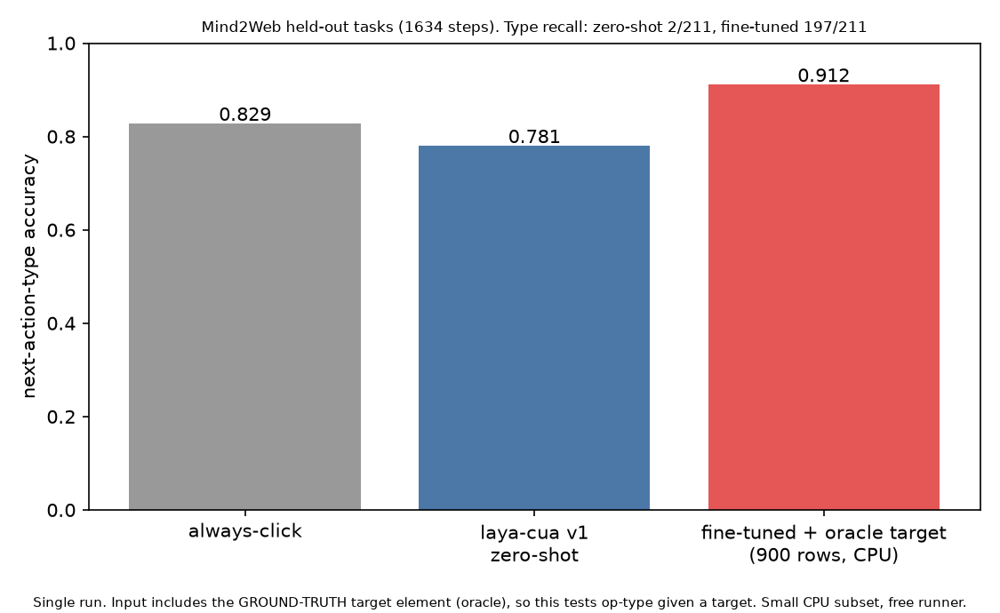
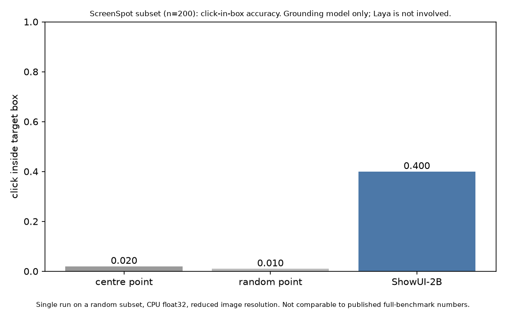
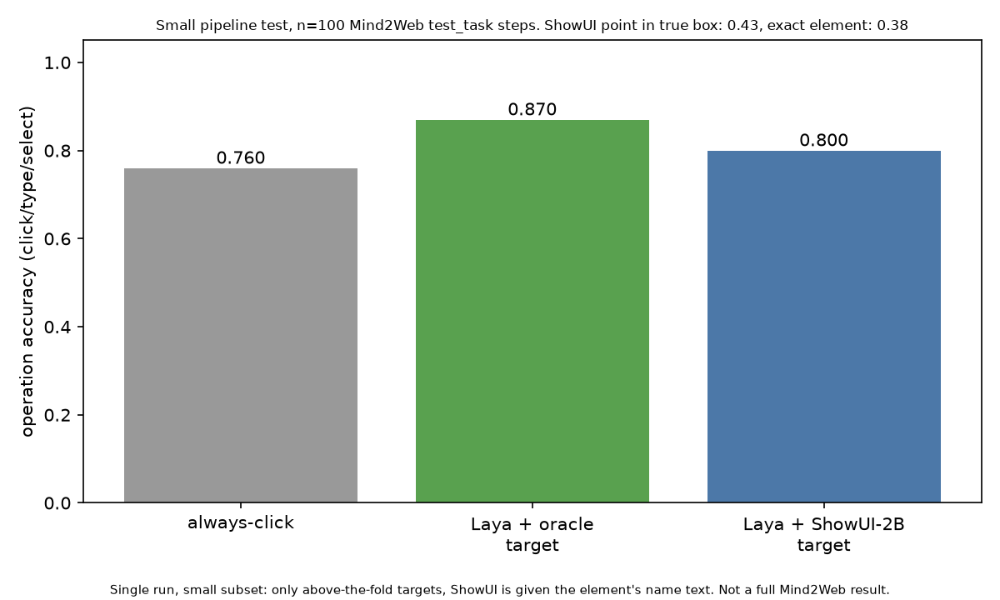

# laya-cua

Notebook: [laya_cua_finetune.ipynb](laya_cua_finetune.ipynb) (outputs cleared; runs on a free Colab T4).

Fine-tune [Laya](https://huggingface.co/convaiinnovations/laya) (421M ModernBERT-based decision encoder) to pick the next **computer-use action type** and whether the task is **done**, from a text description of the screen.

Model: https://huggingface.co/sodan/laya-cua (Apache-2.0)

## What it does
Given a task, a text screen description and the last few steps, one forward pass returns:
- the next action type: click, type, key, scroll, move, wait, drag, done
- the probability that the task is already finished

## What it does not do
No text generation, no click coordinates, no screenshots. It is a fast decision layer to sit next to whatever produces the target and the typed text. Unsloth does not apply: Laya is an encoder with a typed head, not an autoregressive LLM.

## Results (held-out, n=334 rows, single run each, free Colab T4)
| version | change | action_type | task_done |
|---|---|---|---|
| v0 | 200 AgentNet tasks, 2 epochs | 0.7665 | 0.9581 |
| v1 | 400 tasks, 2 epochs | 0.8084 | 0.9611 |
| base Laya | none | 0.1856 | 0.7066 |
| always "click" | none | 0.7156 | not computed |

Limits: small test set, one run per version, about 94% of rows are "not done" so task_done is near a trivial baseline, trained on AgentNet text descriptions only. Details and the live results log are on the model card.

## Function-calling routing (separate task)
Laya also decides call / no-call and which function on glaive-function-calling-v2. Test tool_call accuracy 0.9573 (base 0.3042, always no-call 0.648). Which-function is near ceiling for base Laya, so that gain is not meaningful. One run per library version, no confidence intervals. Weights (now inside the one model repo): https://huggingface.co/sodan/laya-cua/tree/main/function_calling. Details: [function_calling/RESULTS.md](function_calling/RESULTS.md).

## Files
- `agentnet_to_laya.py`: converts OpenCUA AgentNet (MIT) trajectories into Laya rows.
- `function_calling/laya_fc.py`: the function-calling routing run.
- Training: the official `laya.train` RLCD loop on one T4 (single run recipe: 2 epochs, encoder LR 2.5e-5, head LR 1e-4, batch 64). A notebook will be added to this repo.

## Mind2Web CPU fine-tune rerun (negative result)

Run on a free GitHub Actions runner (CPU only, $0): https://github.com/somdipto/laya-cua/actions/runs/44786704167. Script: `m2w_cpu_finetune.py`. Raw numbers: `results/m2w_cpu_results.json`, log: `results/m2w_cpu_log.txt`.

Task: next action type on Mind2Web (osunlp/Mind2Web, CC-BY-4.0), text of the cleaned HTML only, whole tasks held out, 1634 eval steps.

| Model | Accuracy | Type recall |
|---|---|---|
| always-click | 0.8286 | n/a |
| laya-cua v1, zero-shot | 0.7809 | 2/211 |
| fine-tuned, 1 epoch, 900 train rows, CPU | 0.8286 | 0/211 |

The fine-tuned model predicts "click" for every step, so it matches always-click and adds nothing. Single run, one seed, 900 of 6141 train rows, 512-token inputs, one epoch, because of the free CPU limit. This does not show what a full-data GPU fine-tune would do. The chart is on the model card: https://huggingface.co/sodan/laya-cua

### More Mind2Web runs: all three fine-tunes collapse to click (negative result)
Same eval for every row: 1634 held-out-task steps, always-click 0.8286, laya-cua v1 zero-shot 0.7809 (TYPE recall 2/211). Each fine-tune is a single run, single seed.

| Run | Train rows | Accuracy | TYPE recall | Predicts |
|---|---|---|---|---|
| CPU, GitHub Actions, 1 epoch | 900 | 0.8286 | 0/211 | click on every step |
| CPU, class-balanced, 1 epoch (https://github.com/somdipto/laya-cua/actions/runs/44835333968) | 900 | 0.8286 | 0/211 | click on every step |
| GPU, free Colab T4, 1 epoch, train loss 2.43 | 6141 | 0.8286 | 0/211 | click on every step |

Check on the GPU checkpoint: with max_len 512 or 1024 and with the fitted or neutral temperature, it still predicts click for all of 100 TRAIN rows it saw (47 type, 13 select, 40 click; accuracy 0.40, the click share) and for 300 held-out rows (0.763). So the collapse is not an eval-config artifact.

Likely cause (hypothesis, not tested): the input is the task, the first 1500 characters of page text and recent steps. On Mind2Web the operation depends on which element is the target, and the target is not in the input, so predicting the majority class is the best the model can do here. The next experiment adds the target element's tag and attributes to the input. This does not say Laya cannot work as a decision layer; it says this recipe on this input does not.

### Positive result with an oracle target: Mind2Web operation type, target element given
Same 1634 held-out-task steps. The input now also has the recorded GROUND-TRUTH target element (tag and a few attributes) for the step. No model picks that element, so this is not end-to-end. It tests one thing: given a target, can Laya choose click, type or select. Free GitHub Actions CPU runner, 900 class-balanced train rows (450 click, 300 type, 150 select), 1 epoch, train loss 0.88, single run, one seed. Run: https://github.com/somdipto/laya-cua/actions/runs/44865069411 . Raw numbers: https://github.com/somdipto/laya-cua/blob/main/results/m2w_target_results_target900.json

| Model | Accuracy | TYPE recall |
|---|---|---|
| always-click | 0.8286 | n/a |
| laya-cua v1 zero-shot (no target in input) | 0.7809 | 2/211 |
| fine-tuned, no target in input (3 runs above) | 0.8286 | 0/211 |
| fine-tuned, oracle target in input | 0.9119 | 197/211 |

Predicted mix: 1250 click, 316 type, 68 select. This is 8 points above always-click and the first fine-tune here that is not all-click, which supports the hypothesis that the missing target element was the cause. Caveats: single run, the target is the ground-truth element, only 900 of 6141 train rows were used, and the 8-point gap is on one split with no confidence interval. A real agent would need a separate model to choose the target.

### Grounding check: ShowUI-2B on ScreenSpot (reference model, Laya not involved)
This measures a separate grounding model (showlab/ShowUI-2B, MIT), not Laya. It is the kind of model that would pick the target for Laya's decision. Metric: the predicted click point falls inside the target box. Random 200-sample subset of ScreenSpot (rootsautomation/ScreenSpot, apache-2.0, 1272 total), single run, free GitHub Actions CPU in float32, image resolution cut to at most 400*28*28 pixels for speed. Run: https://github.com/somdipto/laya-cua/actions/runs/44886978790 . Raw numbers: https://github.com/somdipto/laya-cua/blob/main/results/screenspot_results_ss.json

| | click-in-box accuracy (n=200) |
|---|---|
| centre-of-screen point | 0.020 |
| random point | 0.010 |
| ShowUI-2B (reduced resolution, CPU) | 0.400 |

By type: text 0.378 (n=111), icon 0.427 (n=89). By source: android 0.71 (31), ios 0.52 (46), windows 0.45 (29), forum 0.30 (20), macos 0.27 (26), shop 0.21 (19), gitlab 0.17 (12), tool 0.12 (17). Small per-source counts.

Caveat: 0.40 is far below what the ShowUI authors report for the full benchmark at full resolution. I did not find the cause. The cut in image resolution is the most likely factor, but that is a guess, not tested. Do not compare this number with published ones. It only shows a small grounding model gets the target right clearly more often than chance on a subset. No end-to-end pipeline (Laya plus a grounding model on the same steps) has been run or measured.

### Small pipeline test: ShowUI-2B picks the target, Laya decides the operation (n=100, single run)
Two models on the same 100 steps from the Multimodal-Mind2Web test_task split (osunlp/Multimodal-Mind2Web, OpenRAIL licence). ShowUI-2B (MIT) gets a screenshot and the element's name text and returns a click point. The point is mapped to the smallest candidate element box that contains it. Laya (re-trained for this run on 900 class-balanced Mind2Web text rows, 1 epoch, train loss 1.22) gets that element's tag and attributes plus the task and page text and picks click, type or select. Free GitHub Actions CPU, about 3.6 hours. Run: https://github.com/somdipto/laya-cua/actions/runs/44900747967 . Raw numbers: https://github.com/somdipto/laya-cua/blob/main/results/pipeline_results_pipe.json.

| Setup | Operation accuracy (n=100) | TYPE recall (n=23) |
|---|---|---|
| always-click (76 click, 23 type, 1 select) | 0.76 | 0/23 |
| Laya + ground-truth target element | 0.87 | 21/23 |
| Laya + ShowUI-2B's target | 0.80 | 11/23 |

ShowUI's click point fell inside the true target box on 43 of 100 steps, and it selected the exact right element on 38 of 100. Laya's operation accuracy dropped from 0.87 to 0.80 when it was given ShowUI's element instead of the true one. It stays 4 points above always-click, which is within what 100 steps can resolve (about +-8 points), so treat this as a hint, not a confirmed gain.

Caveats: 100 steps, one run, one seed. Only steps whose target sits in the top 1280x720 of the page were used, because ShowUI expects a viewport screenshot (285 rows scanned to find 100). ShowUI was given the element's name from the annotation, which makes grounding easier than with a task alone. Screenshots were resized to 1008x560. Past steps in the history use the dataset's role names, while training used HTML tags. Only 1 of the 100 steps was a select. Not comparable with published Mind2Web numbers. Laya still does not output coordinates or text.
